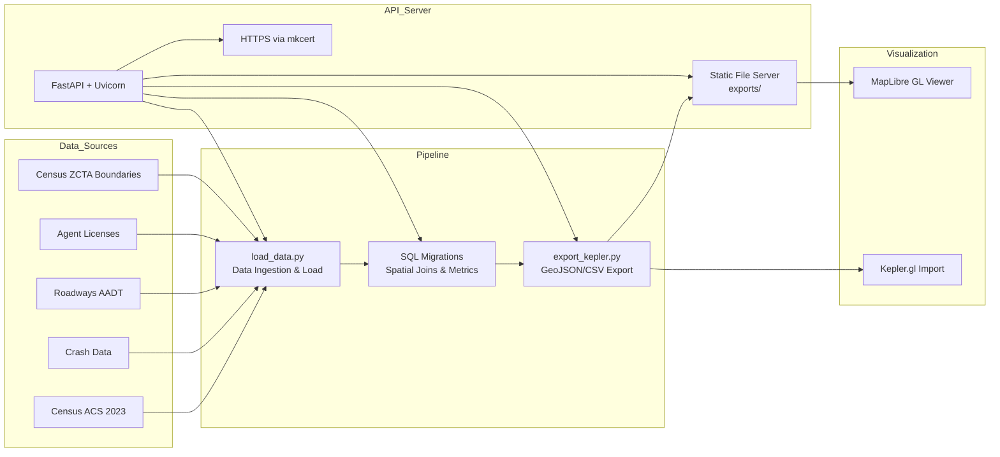

# Insurance Geospatial Intelligence

[](https://www.python.org/)
[](https://fastapi.tiangolo.com/)
[](https://www.sqlalchemy.org/)
[](https://www.uvicorn.org/)
[](https://www.postgresql.org/)
[](https://postgis.net/)
[](https://releases.ubuntu.com/jammy/)

## Abstract

A location intelligence platform for the insurance market. Ingests public demographic, mobility, and risk data, performs spatial joins, and outputs a unified metric layer per ZIP code (ZCTA) for visualization in MapLibre GL and Kepler.gl. Provides actionable insights for office placement, digital campaign geo-targeting, and market segmentation analysis.

**_This repo was tested on Ubuntu 24.04 LTS with PostgreSQL 15+ and PostGIS 3+._**


> [!NOTE]
> Large data files (>100MB) are stored in this repository via **Git LFS**. The installer looks for `resources/data.zip` and extracts it to `data/` at runtime. **After cloning, run `git lfs pull` to download the data archive** (758 MB).

----

## Features

- ***Modular Architecture*** – Organized pipeline (`src/insurance_platform/`), API (`main.py`), and static exports (`exports/`)
- ***Full Data Pipeline*** – Census ACS demographics, crash/traffic data, agent licenses, ZCTA boundaries
- ***Spatial Analytics*** – PostGIS-powered spatial joins, 3,048 ZIP codes analyzed
- ***Derived Metrics*** – Vulnerability Index, Visibility Multiplier, Risk Alignment, market segment scores (0–100%)
- ***Market Segmentation*** – 8 segments: Prime/Strong Standard, Prime/Strong Non-Standard, Spanish Standard/Non-Standard, Market Gap, Moderate
- ***FastAPI Server*** – HTTPS with auto-generated certs (mkcert), CORS, background pipeline execution, REST endpoints
- ***Interactive MapLibre Viewer*** – 8-stop opportunity gradient, keyboard navigation, mobile drawer, WCAG 2.1 AA
- ***Kepler.gl Export*** – GeoJSON + CSV + config for advanced exploration
- ***Automated Installation*** – `installer.sh` handles system deps, uv venv, SSL certs, config template

----

## Flowchart



---

## Table of Contents

- [Information Sources](#information-sources)
- [Requirements](#requirements)
   - [Software](#software)
- [Installation](#installation)
- [Project Structure](#project-structure)
- [Usage or Quick Start](#usage-or-quick-start)
- [API Endpoints](#api-endpoints)
- [Configuration](#configuration)
- [Data Sources](#data-sources)
- [Metrics](#metrics)
- [Troubleshooting](#troubleshooting)
- [Credits](#credits)

---

## Information Sources

- Census ACS API: https://www.census.gov/data/developers/data-sets/acs-5year.html
- Crash Data Sources: State DOT crash databases
- Agent Licenses: State insurance department license lookups

---

## Requirements

### Software

- Ubuntu 22.04 or similar Linux distribution
- Python 3.12+
- PostgreSQL 15+ with PostGIS 3+ extension
- Required APT packages: `python3-dev`, `python3-venv`, `postgresql`, `postgis`, `gdal-bin`, `sqlite3`, `sqlitebrowser`, `curl`, `mkcert`, `libnss3-tools` (handled by installer)
- `uv` for fast Python package management (installed by installer)

---

## Installation

**Clone the repository**

```bash
git clone git@github.com:TheBIGduke/insurance-geospatial-intelligence.git
cd insurance-geospatial-intelligence
```

**Run the Automated Installer**

The included `installer.sh` script handles system dependencies, creates a virtual environment using `uv`, sets up local SSL certificates with `mkcert`, initializes the configuration from a template, **and extracts `resources/data.zip` to `data/`** (downloaded via Git LFS).

```bash
git lfs install    # One-time setup (run once per machine)
git lfs pull       # Download data.zip (758 MB)
bash installer.sh
```

**Installer Options:**
- `--clear` or `-c`: Clear and recreate the existing virtual environment
- `--overwrite` or `-o`: Overwrite existing configuration files

> [!IMPORTANT]
> The installer creates a data directory at `~/.insurance_platform/` containing the configuration file (`config/config.yaml`). You must update the database credentials in this file before running the pipeline.
>
> **Data files:** The installer expects `resources/data.zip` (stored via **Git LFS**, 758 MB). Run `git lfs install && git lfs pull` after cloning to download it. If missing, the installer creates an empty `data/` directory and you must manually add the required files (see [Data Sources](#data-sources)).

**Database Setup**

After installation, create the PostgreSQL database and enable PostGIS:

```bash
sudo -u postgres createdb insurance_geospatial_intelligence
sudo -u postgres psql -d insurance_geospatial_intelligence -c "CREATE EXTENSION postgis;"
```

**Configure Database Credentials**

Edit `~/.insurance_platform/config/config.yaml` and update the `database` section with your PostgreSQL credentials.

**Verify the Installation**

```bash
source .venv/bin/activate
uv pip list
```

---

## Project Structure

```bash
insurance-geospatial-intelligence
├── certs/                    # SSL certificates (generated by installer)
├── config/
│   └── config_template.yaml  # Configuration template
├── data/                     # Raw data files (created by installer from resources/data.zip)
├── deploy/                   # Deployment scripts
├── exports/                  # MapLibre viewer + Kepler.gl exports
│   ├── index.html           # MapLibre GL dashboard
│   ├── style.css            # Design system (47 CSS tokens)
│   ├── app.js               # Viewer logic (state machine, filters, keyboard)
│   ├── zip_opportunity_metrics.geojson
│   ├── zip_opportunity_metrics.csv
│   └── kepler_config.json   # Kepler.gl visualization config
├── resources/               # Data archive (tracked via Git LFS)
│   └── data.zip             # Compressed data files (~758 MB) — downloaded via `git lfs pull`
├── src/insurance_platform/  # Core Python package
│   ├── __init__.py
│   ├── config.py            # Shared config constants
│   ├── load_data.py         # Data ingestion pipeline
│   ├── export_kepler.py     # Kepler.gl export
│   └── geocode_utils.py     # Geocoding helpers
├── sql/                     # SQL migration files
│   ├── 01_create_schema.sql
│   ├── 02_spatial_joins.sql
│   └── 03_derived_metrics.sql
├── installer.sh             # Automated setup script (unzips resources/data.zip → data/ if present)
├── main.py                  # FastAPI server (HTTPS, API, static files)
├── run_pipeline.py          # CLI pipeline runner
├── settings.py              # Settings loader (YAML + env)
├── requirements.txt         # Python dependencies (pinned)
├── pyproject.toml           # Project metadata + uv build config
├── .pre-commit-config.yaml  # Pre-commit hooks
└── README.md
```

---

## Usage or Quick Start

### 1. Activate Virtual Environment

```bash
source .venv/bin/activate
```

### 2. Prepare Data Files

**Option A — Use `resources/data.zip` via Git LFS (recommended):**
Run `git lfs install && git lfs pull` after cloning to download the data archive. The installer will extract it to `data/` automatically.

**Option B — Manual placement:**
If `resources/data.zip` is not present, the installer creates an empty `data/` directory. Manually add these files:

| File | Description | Source |
|------|-------------|--------|
| `tl_2026_us_zcta520.zip` | ZCTA boundaries | Census 2026 |
| `my_list.csv` | Crash data | State DOT |
| `Insurance_agents_...csv` | Agent licenses | State Insurance Dept |
| `ACSST1Y2025.S2504-....csv` | Demographics | Census ACS |
| `txdot_roads.shp` | Road network + AADT | State DOT |

> [!IMPORTANT]
> The `data/` folder is git-ignored (see `.gitignore`). `resources/data.zip` is **tracked via Git LFS** (758 MB). Run `git lfs pull` after cloning to download it.

### 3. Run the Full Pipeline

```bash
python run_pipeline.py
```

Or run individual phases:

```bash
python run_pipeline.py --only-load    # Phase 1: Data loading only
python run_pipeline.py --only-sql     # Phase 2: Spatial joins + metrics
python run_pipeline.py --only-export  # Phase 3: Kepler.gl export
```

### 4. Start the Visualization Server

```bash
python main.py
# Opens at https://localhost:8080 (or HTTP if no certs)
```

### 5. Open in Browser

- **MapLibre Dashboard**: `https://localhost:8080`
- **API Docs**: `https://localhost:8080/docs`
- **Health Check**: `https://localhost:8080/health`
- **Pipeline Status**: `https://localhost:8080/api/status`

> [!TIP]
> The FastAPI server auto-generates SSL certificates via `mkcert`. If certificates exist in `certs/`, HTTPS is used automatically. Browser will trust the cert if you ran `mkcert -install` (done by installer).

---

## API Endpoints

| Method | Endpoint | Description |
|--------|----------|-------------|
| `GET` | `/` | Serve MapLibre viewer (`index.html`) |
| `GET` | `/health` | Health check |
| `GET` | `/api/status` | Get pipeline execution status |
| `GET` | `/api/metrics/summary` | Summary statistics from opportunity metrics |
| `POST` | `/api/pipeline/run` | Run full pipeline (background) |
| `POST` | `/api/pipeline/load` | Run data loading only |
| `POST` | `/api/pipeline/sql` | Run SQL pipeline only |
| `POST` | `/api/pipeline/export` | Run export only |

**Example: Start Pipeline via API**
```bash
curl -X POST https://localhost:8080/api/pipeline/run \
  -H "Content-Type: application/json" \
  -d '{"skip_load": false, "skip_sql": false, "skip_export": false}'
```

---

## Configuration

Configuration is loaded from `~/.insurance_platform/config/config.yaml` (created by installer from `config/config_template.yaml`).

Key sections:

```yaml
API:
  version: "1.0.0"
  host: "0.0.0.0"
  port: 8080

database:
  host: "localhost"
  port: 5432
  name: "insurance_geospatial_intelligence"
  user: "your_user"
  password: "your_password"
  pool_size: 5
  max_overflow: 10

census:
  api_key: ""  # Optional: for live ACS API calls

data:
  zcta_shapefile: "data/tl_2026_us_zcta520.zip"
  crash_csv: "data/my_list.csv"
  agents_csv: "data/Insurance_agents,_adjusters,_and_people_approved_to_manage_insurance-related_products_or_claims_20261118.csv"
  census_csv: "data/ACSST1Y2025.S2504-Data.csv"
  roads_shapefile: "data/txdot_roads.shp"

export:
  dir: "exports"
  geojson_filename: "zip_opportunity_metrics.geojson"
  csv_filename: "zip_opportunity_metrics.csv"
```

---

## Data Sources

| Layer | Source | Records | Description |
|-------|--------|---------|-------------|
| ZIP Boundaries | Census 2026 ZCTA | 3,048 | ZCTA520 shapefile |
| Crashes | State DOT Crash Data | 37,876 | Crash points with severity |
| Agent Licenses | State Insurance Dept | 260,000+ | Active agents/adjusters (Appointment type) |
| Demographics | Census ACS 2023 | ZIP-level | Income, housing, language, vehicles |
| Traffic (AADT) | State DOT Roadways | 576,000+ segments | Annual Average Daily Traffic |

---

## Metrics

### Core Metrics (per ZIP Code)

- `total_crashes`, `crashes_per_sqkm`
- `total_competitors`, `franchise_competitors`, `independent_competitors`
- `avg_aadt`, `max_aadt`
- `median_home_value`, `median_household_income`
- `vehicles_per_household`, `renter_pct`, `spanish_speaking_pct`

### Derived Metrics (0–100%)

| Metric | Purpose | Key Inputs |
|--------|---------|------------|
| `vulnerability_index` | Competitive weakness | Competitor density, review proxy, traffic visibility |
| `visibility_multiplier` | Location exposure | Avg/max AADT, road density |
| `risk_alignment` | Loss risk fit | Crash density, severe crash %, hail proxy |
| `standard_market_score` | Standard carrier fit | Home value, vehicles/HH, franchise dealers, income, renter % |
| `non_standard_market_score` | Non-standard carrier fit | Renter %, independent dealers, income, crash density, Spanish % |
| `overall_opportunity_score` | Composite opportunity | Weighted blend |
| `market_segment` | Classification | 8 segments (see below) |

### Market Segments

1. **Prime_Standard** – High standard score, strong demographics
2. **Strong_Standard** – Good standard score
3. **Prime_NonStandard** – High non-standard score
4. **Strong_NonStandard** – Good non-standard score
5. **Spanish_Standard** – High Spanish %, standard fit
6. **Spanish_NonStandard** – High Spanish %, non-standard fit
7. **Market_Gap_Opportunity** – Low competition, high need
8. **Moderate** – Balanced / no clear signal

---

## Troubleshooting

**Problem:** `psql: connection refused`
**Solution:** Ensure PostgreSQL is running: `sudo systemctl start postgresql`. Verify database exists and user has permissions.

**Problem:** `PostGIS extension not found`
**Solution:** Run `sudo -u postgres psql -d insurance_geospatial_intelligence -c "CREATE EXTENSION postgis;"`

**Problem:** `mkcert: command not found`
**Solution:** Install mkcert: `sudo apt install mkcert libnss3-tools` then run `mkcert -install`

**Problem:** Pipeline fails at data loading
**Solution:** Check `data/` directory has all required files with correct names. Verify CSV encoding (UTF-8).

**Problem:** MapLibre viewer shows blank map
**Solution:** Ensure pipeline completed successfully (check `exports/zip_opportunity_metrics.geojson` exists). Check browser console for CORS errors.

**Problem:** `uv: command not found`
**Solution:** Install uv: `curl -LsSf https://astral.sh/uv/install.sh | sh` then restart shell.

---
## Credits

+ **Author:** Kaléin Tamaríz
